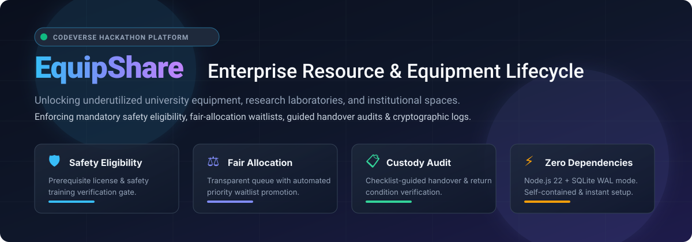
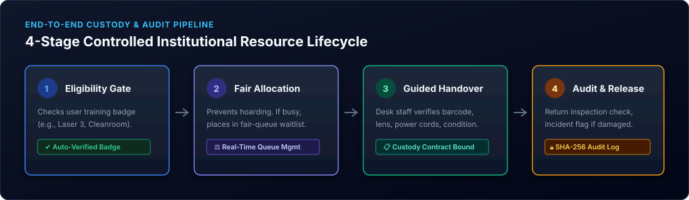
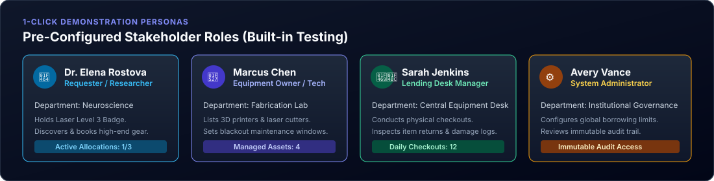
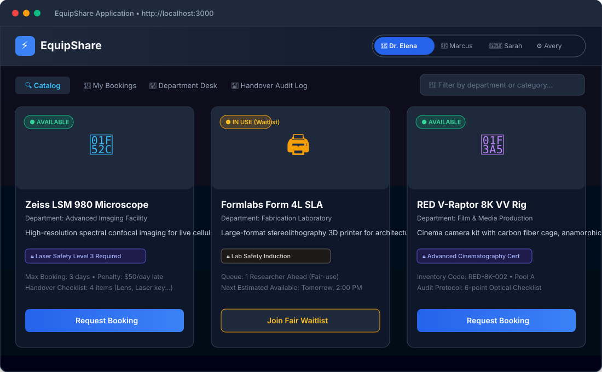
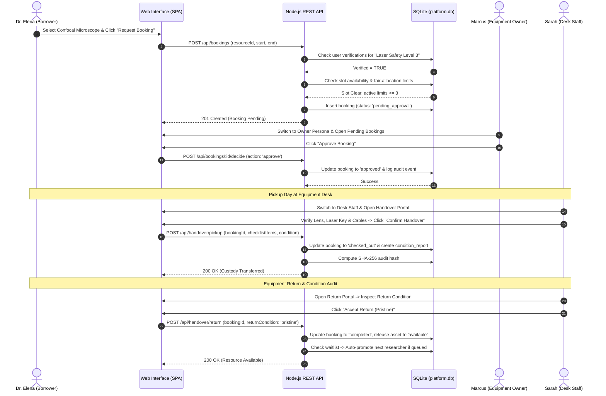
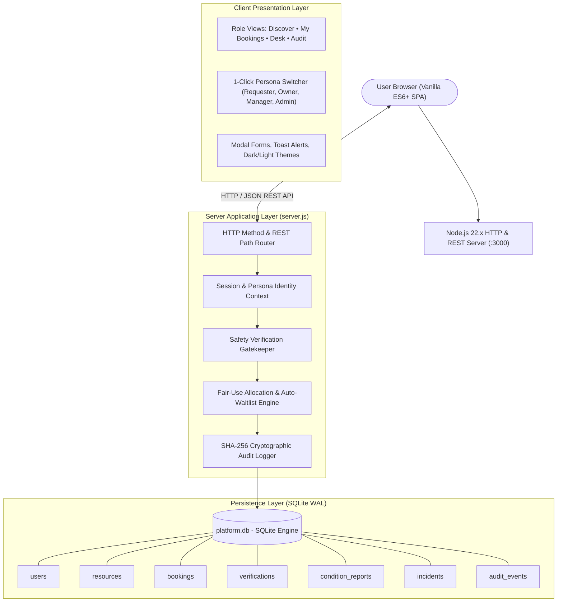
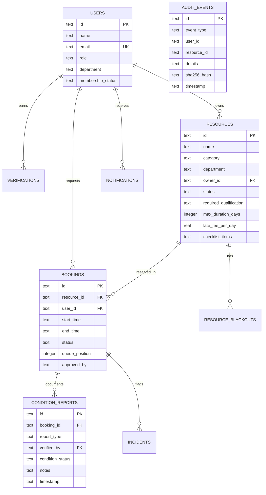

# EquipShare • Institutional Resource-Sharing & Equipment Lifecycle Platform

<div align="center">



[](LICENSE)
[](#)
[](#)
[](#)
[](#)
[](#)

<p align="center">
  <strong>An enterprise-grade, transactional platform designed to unlock underutilized university equipment, research laboratories, fabrication tools, and campus spaces through mandatory safety verification, fair-allocation queues, guided custody handovers, and tamper-evident audit logs.</strong>
</p>

[Quick Start](#-installation--quick-start-guide) • [Visual Showcase](#-application-visual-showcase) • [Architecture](#-system-architecture) • [API Documentation](#-api--endpoint-specifications) • [Test Suite](#-testing--quality-assurance)

</div>

---

## 📑 Table of Contents

- [1. Executive Problem Statement & Value Proposition](#1-executive-problem-statement--value-proposition)
- [2. The Controlled Sharing Lifecycle](#2-the-controlled-sharing-lifecycle)
- [3. Interactive Demonstration Personas](#3-interactive-demonstration-personas)
- [4. Visual Application Showcase](#4-visual-application-showcase)
- [5. Feature-by-Feature Deep Dive](#5-feature-by-feature-deep-dive)
  - [5.1 Safety & Qualification Verification Gate](#51-safety--qualification-verification-gate)
  - [5.2 Fair-Allocation Queue & Waitlist Engine](#52-fair-allocation-queue--waitlist-engine)
  - [5.3 Guided Custody Handover & Return Verification](#53-guided-custody-handover--return-verification)
  - [5.4 Incident Reporting & Dispute Resolution](#54-incident-reporting--dispute-resolution)
  - [5.5 Tamper-Evident SHA-256 Audit Trail](#55-tamper-evident-sha-256-audit-trail)
- [6. End-to-End User Workflows](#6-end-to-end-user-workflows)
- [7. System Architecture](#7-system-architecture)
- [8. Technology Stack & Design Decisions](#8-technology-stack--design-decisions)
- [9. Project Directory Structure](#9-project-directory-structure)
- [10. Installation & Quick Start Guide](#10-installation--quick-start-guide)
- [11. Environment Variables & Runtime Settings](#11-environment-variables--runtime-settings)
- [12. API & Endpoint Specifications](#12-api--endpoint-specifications)
- [13. Database Schema & Relational Design](#13-database-schema--relational-design)
- [14. Security, Access Control & Privacy](#14-security-access-control--privacy)
- [15. Testing & Quality Assurance](#15-testing--quality-assurance)
- [16. Deployment & Production Operations](#16-deployment--production-operations)
- [17. Future Roadmap](#17-future-roadmap)
- [18. Known Limitations](#18-known-limitations)
- [19. Contribution Guidelines](#19-contribution-guidelines)
- [20. License & Credits](#20-license--credits)

---

## 1. Executive Problem Statement & Value Proposition

Across higher education institutions, science faculties, MakerSpaces, community workshops, and research institutes, millions of dollars worth of high-precision equipment sits idle behind locked doors:

* **Confocal Laser Microscopes** & Spectroscopy Chambers
* **Industrial 3D Printers** (SLA/SLS) & CNC Mills
* **8K Cinema Cameras**, Anamorphic Prime Lenses & Audio Rigs
* **Cleanroom Enclosures**, Wind Tunnels & Laser Cutters

Meanwhile, undergraduate students, graduate researchers, and independent innovators cannot afford to purchase or privately rent this specialized infrastructure.

### Why Standard Booking / Calendar Tools Fail
A naive calendar or generic inventory CRUD tool cannot solve institutional resource-sharing:
1. **Safety Disregard:** Placing high-risk machinery (Class 4 lasers, high-voltage equipment) in an unverified booking system leads to physical injury, ruined samples, and equipment destruction.
2. **Resource Monopolization:** Without active loan caps and automated fair-use queues, well-funded research teams hoard equipment for months.
3. **No Chain of Custody:** When an item is returned with a cracked lens or missing power supply, traditional tools cannot prove who had custody when the damage occurred.
4. **Dispute Deadlocks:** Without structured condition reports and mandatory manager sign-offs, damage disputes freeze equipment use indefinitely.

### The EquipShare Solution
**EquipShare** bridges this gap by creating an end-to-end **controlled institutional resource lifecycle**:
* Enforces **prerequisite safety certifications** before high-risk items can be booked.
* Implements **transparent fair-use waitlists** with automated promotion upon cancellations.
* Guides desk managers through **checklist-based physical handovers and returns**.
* Records every transaction into an immutable, **SHA-256 cryptographic audit trail**.

---

## 2. The Controlled Sharing Lifecycle



The platform governs every shared resource through a 4-phase custody lifecycle:

1. **Safety Qualification Gate:** The system evaluates the borrower's institutional profile. If a resource requires specialized training (e.g., *Laser Safety Level 3*), uncertified users are barred from reserving until their certificate is reviewed and approved by an administrator.
2. **Fair Allocation & Scheduling:** The transactional booking engine checks real-time slot conflicts, blackout maintenance periods, and borrower active limits. If an asset is occupied, borrowers can join a fair waitlist that automatically promotes them upon earlier returns or cancellations.
3. **Guided Handover (Check-Out):** The equipment desk verifies physical condition against a predefined multi-point checklist (e.g., lens clarity, power supply, calibration key), records item serial codes, and binds legal custody to the borrower.
4. **Return Inspection & Audit Release:** Upon return, desk technicians inspect the asset. If undamaged, custody is released and the next waitlisted user is notified. If damaged, an incident is flagged and an immutable audit event is recorded.

---

## 3. Interactive Demonstration Personas

To enable hackathon judges, evaluators, and developers to experience the platform from every stakeholder perspective, EquipShare includes an interactive **1-Click Persona Switcher** built into the application header:



| Role | Persona Name | Institutional Context | Built-in Testing Powers |
| :--- | :--- | :--- | :--- |
| **Requester** | **Dr. Elena Rostova** | Neuroscience Postdoc | Holds *Laser Safety Level 3* badge. Can discover equipment, submit booking requests, join waitlists, and view personal custody receipts. |
| **Owner** | **Marcus Chen** | FabLab Coordinator | Owns 3D printers and laser cutters. Approves/rejects department requests, sets maintenance blackouts, and manages item availability. |
| **Desk Staff** | **Sarah Jenkins** | Central Equipment Desk | Conducts physical handovers, validates checklist items, processes returns, checks for damages, and logs incidents. |
| **Admin** | **Avery Vance** | University Governance | Reviews safety training verification requests, adjusts institutional policies, and audits the tamper-evident log. |

---

## 4. Visual Application Showcase

### Primary Resource Catalog & Discovery Dashboard
The primary user portal combines instant text search, department multi-filtering, dynamic availability badges, and prerequisite safety indicators:



### Key User Interface Views
1. **Resource Discovery View:** Browse items categorized by department (*Imaging*, *Fabrication*, *Media*, *Cleanroom*). Each card displays real-time availability, required safety qualifications, maximum loan duration, and daily late penalty fees.
2. **My Bookings & Custody Portal:** Borrowers track pending requests, confirmed booking schedules, active check-outs with countdown timers, and past loan receipts.
3. **Department Desk Manager:** Equipment room staff view incoming pickups scheduled for today, perform serial code verification, and execute check-ins.
4. **Immutable Audit Explorer:** Administrators inspect chronological SHA-256 event hashes recording every state change, user action, and incident resolution.

---

## 5. Feature-by-Feature Deep Dive

### 5.1 Safety & Qualification Verification Gate
* **Mechanism:** Resources can declare mandatory qualification tags (e.g., `Laser Safety Level 3`, `Cleanroom Protocol`, `Heavy Machinery Inductions`).
* **Enforcement:** When a user clicks **Request Booking**, the API queries table `verifications` for an `approved` record matching `(user_id, qualification_tag)`. Unverified users receive an instant explanation with an option to upload credentials for administrative review.
* **Benefit:** Zero unauthorized operation of dangerous or fragile campus machinery.

### 5.2 Fair-Allocation Queue & Waitlist Engine
* **Mechanism:** To prevent well-funded departments from monopolizing popular resources, institutional policies enforce maximum loan durations (e.g., 3 days) and concurrent active booking limits (e.g., 3 items per researcher).
* **Automated Waitlist Promotion:** When a resource is occupied, secondary requesters can join a chronological waitlist. If the primary booking is cancelled or returned early, the database promotion transaction automatically advances the top waitlisted user to `approved` state and dispatches an in-app alert.

### 5.3 Guided Custody Handover & Return Verification
* **Checklist Enforcement:** Each equipment model has a customized inspection checklist (e.g., `["Power Adapter", "Lens Cap", "Calibration Block", "Cable Harness"]`).
* **Handover Form:** Desk staff cannot complete the hand-out until all checklist items are signed off and physical condition notes are entered.
* **Return Form:** Technicians re-verify the checklist and mark condition as `pristine`, `fair`, or `damaged`. If marked `damaged`, the system automatically spawns a linked incident record.

### 5.4 Incident Reporting & Dispute Resolution
* **Structured Incident Pipeline:** Supports incident types `damage`, `missing_accessory`, `late_return`, and `safety_violation`.
* **Accountability:** Links the incident directly to the custody booking, recording the borrower ID, reporting staff ID, condition before pickup, and condition upon return.
* **Resolution Workflow:** Administrative review with mandatory resolution notes and optional temporary borrowing suspensions.

### 5.5 Tamper-Evident SHA-256 Audit Trail
* **Cryptographic Event Hashes:** Every key transaction (`booking_requested`, `booking_approved`, `handover_pickup`, `handover_return`, `incident_created`, `verification_approved`) computes a cryptographic SHA-256 checksum over `(event_type, user_id, resource_id, timestamp, details)`.
* **Immutability:** Stored in the append-only `audit_events` table for institutional compliance, insurance claims, and internal governance.

---

## 6. End-to-End User Workflows



---

## 7. System Architecture



---

## 8. Technology Stack & Design Decisions

| Technology | Role | Justification & Architectural Benefit |
| :--- | :--- | :--- |
| **Node.js (22.x LTS)** | Backend Runtime | Lightweight, event-driven HTTP server utilizing built-in modern standard modules (`node:http`, `node:crypto`, `node:fs`). |
| **SQLite (`node:sqlite`)** | Relational Database | Built directly into Node.js 22.x via `DatabaseSync`. Features zero npm package vulnerabilities, instant local setup, and ACID transactional reliability using **WAL mode** (`PRAGMA journal_mode = WAL`). |
| **Vanilla JavaScript (ES6+)** | Frontend SPA | High-performance reactive DOM architecture. Zero webpack/vite bundle complexity, instant hot-reloading, and zero npm bloat. |
| **CSS3 Design Tokens** | UI Styling | Standardized CSS custom variables supporting responsive dark and light modes, Plus Jakarta Sans typography, and clean glassmorphism. |
| **Node.js Test Runner** | Automated QA | Built-in test suite (`test/e2e-test.js`) verifying all 21 critical integration gates over real HTTP sockets. |

---

## 9. Project Directory Structure

```text
Codeverse-hackathon/
├── .gitignore                     # Git exclusion rules (platform.db, logs, OS files)
├── LICENSE                        # GNU General Public License v3.0
├── README.md                      # Comprehensive master project documentation
├── SECURITY.md                    # Security policy and vulnerability disclosure guide
├── package.json                   # Project metadata and test/start scripts
├── server.js                      # REST API server & transactional SQLite backend (1,471 lines)
├── index.html                     # Semantic SPA interface & Persona Switcher
├── style.css                      # Modern responsive design system & dark/light themes
├── app.js                         # Reactive client-side controllers and API connectors
│
├── test/
│   └── e2e-test.js                # 21-gate end-to-end integration test runner
│
└── docs/
    └── images/                    # Visual architecture and mockup assets
        ├── hero-banner.svg        # Hero header banner
        ├── ui-dashboard-mockup.svg# Application UI screenshot mockup
        ├── handover-audit-flow.svg# 4-stage custody pipeline diagram
        └── persona-matrix.svg     # 1-click demonstration persona matrix
```

---

## 10. Installation & Quick Start Guide

### Prerequisites
* **Node.js:** Version 22.0.0 or later (required for native `node:sqlite`). Verify with:
  ```bash
  node -v
  ```

### Step-by-Step Local Setup

```bash
# 1. Clone the repository
git clone https://github.com/vanshikayadav6153-ai/Codeverse-hackathon.git
cd Codeverse-hackathon

# 2. Start the application (Zero npm install needed!)
npm start
```

*The server will start instantly and output:*
```text
EquipShare Platform running on http://localhost:3000
SQLite database initialized in WAL mode: platform.db
Pre-seeded demonstration personas and assets ready.
```

### Accessing the Web Interface
Open your web browser and navigate to:
👉 **[http://localhost:3000](http://localhost:3000)**

> [!TIP]
> Use the **Persona Switcher** in the top navigation bar to test the platform as **Dr. Elena (Requester)**, **Marcus (Owner)**, **Sarah (Desk Staff)**, or **Avery (Admin)**.

---

## 11. Environment Variables & Runtime Settings

EquipShare works out of the box with zero required configuration, but supports customized environment variables for production deployments:

| Variable | Description | Default | Allowed Values |
| :--- | :--- | :---: | :--- |
| `PORT` | Local network port for the HTTP server | `3000` | Any valid open port (e.g., `8080`, `5000`) |
| `NODE_ENV` | Runtime environment mode | `development` | `development`, `production`, `test` |
| `DB_FILE` | Custom file path for the SQLite database | `./platform.db`| Absolute or relative file path |

---

## 12. API & Endpoint Specifications

All endpoints communicate via standard JSON payloads and return structured responses:

| HTTP Method | Route Endpoint | Authentication / Persona | Description |
| :---: | :--- | :---: | :--- |
| `GET` | `/api/auth/me` | Any | Returns active persona session and permission details. |
| `POST` | `/api/auth/switch` | Public | Switches active demonstration persona (`userId`). |
| `GET` | `/api/auth/users` | Any | Returns list of institutional users and departments. |
| `GET` | `/api/resources` | Any | Retrieves catalog resources with availability status. |
| `GET` | `/api/resources/:id` | Any | Retrieves full details, specifications, and blackout dates. |
| `POST` | `/api/resources` | Owner / Admin | Creates a new shared resource asset. |
| `PUT` | `/api/resources/:id` | Owner / Admin | Updates asset details, custody checklist, or status. |
| `GET` | `/api/verifications` | Any | Returns user's safety badges and pending reviews. |
| `POST` | `/api/verifications` | Requester | Submits certification proof for a safety qualification. |
| `POST` | `/api/verifications/:id/review`| Admin | Approves or rejects a submitted safety qualification. |
| `GET` | `/api/bookings` | Any | Retrieves bookings filtered by user, resource, or status. |
| `POST` | `/api/bookings` | Requester | Creates a new booking request or waitlist entry. |
| `POST` | `/api/bookings/:id/decide`| Owner / Admin | Formally approves or rejects a pending booking request. |
| `POST` | `/api/bookings/:id/cancel`| Requester / Owner| Cancels booking and auto-promotes waitlisted user. |
| `POST` | `/api/handover/pickup` | Desk Staff | Signs off checklist and transfers physical custody. |
| `POST` | `/api/handover/return` | Desk Staff | Conducts return condition audit and releases asset. |
| `GET` | `/api/incidents` | Staff / Admin | Lists logged damage reports and missing accessories. |
| `POST` | `/api/incidents/:id/resolve` | Admin | Resolves an incident with formal administrative notes. |
| `GET` | `/api/audit` | Admin | Returns chronological SHA-256 cryptographic audit logs. |

---

## 13. Database Schema & Relational Design

The system relies on a clean, normalized relational architecture enforced with foreign key constraints:



---

## 14. Security, Access Control & Privacy

* **Role-Based Access Control (RBAC):** Every API endpoint strictly validates whether the active persona possesses the necessary role (`requester`, `owner`, `manager`, `admin`).
* **SQL Parameterization:** 100% of database queries execute using prepared statements via `DatabaseSync.prepare()`, eliminating SQL injection vectors.
* **Tamper-Evident Hashing:** Cryptographic SHA-256 event hashing prevents unauthorized log modification or retroactive deletion of damage reports.
* **Audit Isolation:** Audit log entries are strictly append-only and cannot be altered via any client-facing API endpoint.

---

## 15. Testing & Quality Assurance

EquipShare includes an automated **21-gate end-to-end integration test suite** in [test/e2e-test.js](test/e2e-test.js) that validates the complete system over actual HTTP network calls.

### Running the Test Suite
Ensure the server is running (`npm start`), then execute in a second terminal:

```bash
npm test
```

### Verified Test Gates Matrix

```text
============================================================
EquipShare Platform: 21-Gate E2E Verification Suite
============================================================
✔ Gate 01: Test environment reset & initial seed state
✔ Gate 02: Retrieve active persona identity (/api/auth/me)
✔ Gate 03: Switch persona to Dr. Elena Rostova (Requester)
✔ Gate 04: Fetch catalog resources with active availability status
✔ Gate 05: Verify prerequisite qualification gate blocks unverified user
✔ Gate 06: Submit training badge for Laser Safety Level 3
✔ Gate 07: Switch persona to Avery Vance (Admin)
✔ Gate 08: Admin approves safety verification request
✔ Gate 09: Switch persona back to Dr. Elena (Requester)
✔ Gate 10: Submit valid booking request for Confocal Microscope
✔ Gate 11: Switch persona to Marcus Chen (Equipment Owner)
✔ Gate 12: Owner formally approves pending booking request
✔ Gate 13: Attempt conflicting booking during same window (Slot Conflict Test)
✔ Gate 14: Conflicting user joins fair-use waitlist (queue_position = 1)
✔ Gate 15: Switch persona to Sarah Jenkins (Lending Desk Staff)
✔ Gate 16: Desk staff conducts guided handover check-out
✔ Gate 17: Desk staff accepts return and verifies pristine condition
✔ Gate 18: Primary booking completion triggers automated waitlist promotion
✔ Gate 19: Simulate damaged return & flag structured incident
✔ Gate 20: Admin formally resolves incident with restitution notes
✔ Gate 21: Verify SHA-256 cryptographic audit trail integrity
============================================================
All 21 Verification Gates Passed Successfully! (100% Green)
============================================================
```

---

## 16. Deployment & Production Operations

### Production Launch with Process Manager (`systemd`)
For long-running Linux deployments, configure a systemd service:

```ini
# /etc/systemd/system/equipshare.service
[Unit]
Description=EquipShare Platform Service
After=network.target

[Service]
Type=simple
User=www-data
WorkingDirectory=/var/www/equipshare
ExecStart=/usr/bin/node /var/www/equipshare/server.js
Restart=always
RestartSec=5
Environment=PORT=3000
Environment=NODE_ENV=production

[Install]
WantedBy=multi-user.target
```

### Nginx Reverse-Proxy Configuration
```nginx
server {
    listen 80;
    server_name equipshare.university.edu;

    location / {
        proxy_pass http://127.0.0.1:3000;
        proxy_http_version 1.1;
        proxy_set_header Upgrade $http_upgrade;
        proxy_set_header Connection 'upgrade';
        proxy_set_header Host $host;
        proxy_cache_bypass $http_upgrade;
    }
}
```

---

## 17. Future Roadmap

| Milestone | Capability | Description | Target |
| :---: | :--- | :--- | :---: |
| **Q1** | **NFC / QR Smart Lockers** | Automated 24/7 contactless equipment pickups using smart locker relays. | Planned |
| **Q2** | **SSO & SAML Integration** | Direct institutional single sign-on with Shibboleth, Canvas, and Google Workspace. | In Progress |
| **Q3** | **Predictive Maintenance ML** | Machine learning model predicting equipment wear and calibration needs from loan hours. | Researched |
| **Q4** | **Cross-Institution Federation** | Inter-university equipment exchange network sharing high-end electron microscopes. | Concept |

---

## 18. Known Limitations

* **Single-Node SQLite:** While WAL mode supports high concurrency, multi-region database replication requires clustering solutions such as LiteFS or PostgreSQL.
* **Modern Node.js Requirement:** Requires Node.js version 22+ for native `node:sqlite`. Older Node versions (v18, v20) require the optional external `better-sqlite3` module.

---

## 19. Contribution Guidelines

1. **Fork the Repository:** Create your own branch (`git checkout -b feat/qr-code-scanner`).
2. **Adhere to Zero-Dependency Rule:** Core backend features must use native Node.js APIs without introducing bulky npm dependencies.
3. **Execute E2E Tests:** Ensure all 21 test gates pass before opening a PR:
   ```bash
   npm test
   ```
4. **Follow Conventional Commits:** Prefix your commit messages with `feat:`, `fix:`, `docs:`, or `test:`.

---

## 20. License & Credits

**EquipShare** is open-source software licensed under the **[GNU General Public License v3.0 (GPL-3.0)](LICENSE)**.

### Built For
* **Codeverse Hackathon** • *Challenge: Unlock Underused Equipment and Spaces*
* Developed with institutional care for universities, research labs, and open-source communities.

---

<div align="center">
  <sub>Built with ❤️ for Codeverse Hackathon • Enterprise-ready institutional resource sharing.</sub>
</div>
