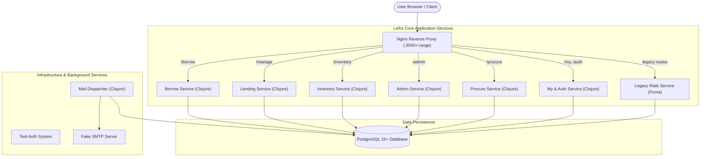
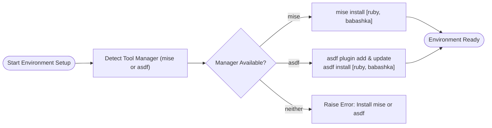
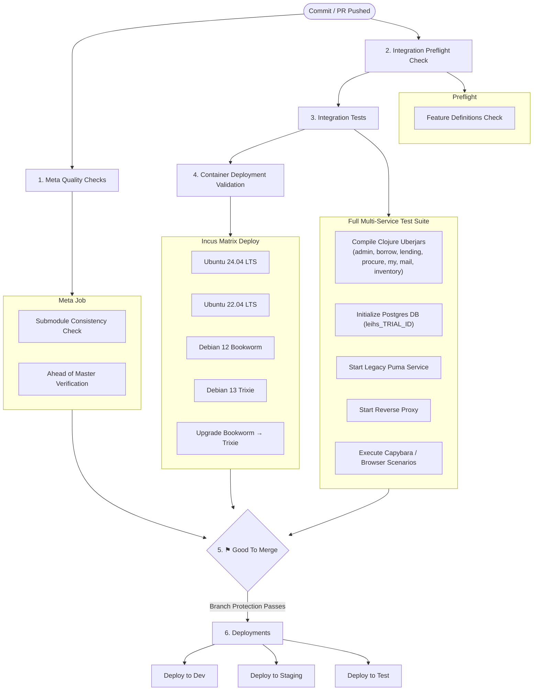

# Leihs End-to-End Workflow & Architecture Guide

## 1. System Overview & Architecture

**Leihs** is a modular, multi-service equipment booking, inventory management, and procurement system widely used by universities (including the Zurich University of the Arts - ZHdK) and other organizations.

This repository serves as the **top-level orchestrator (umbrella repository)** for Leihs version 4+. It integrates multiple specialized service components, manages shared database migrations and libraries, orchestrates end-to-end integration tests, and manages automated container deployments.

### 1.1 Core Modules & Services

| Service / Directory | Technology Stack | Responsibility |
| :--- | :--- | :--- |
| **`borrow`** | Clojure / ClojureScript | User-facing catalog browsing, shopping cart, and equipment reservation workflows. |
| **`lending`** | Clojure / ClojureScript | Equipment hand-out, return, verification, and desk management workflows. |
| **`inventory`** | Clojure / ClojureScript | Inventory registry, item lifecycle tracking, models, categories, and maintenance. |
| **`admin`** | Clojure / ClojureScript | System administration, user & group management, access controls, and settings. |
| **`procure`** | Clojure / ClojureScript | Procurement budgeting, request submission, quotes, and purchase approvals. |
| **`my`** | Clojure / ClojureScript | User profile, personal reservations overview, and authentication dispatcher. |
| **`mail`** | Clojure / JVM | Asynchronous email dispatch, reminder notifications, and background queues. |
| **`legacy`** | Ruby on Rails (Puma) | Backward-compatible Rails endpoints, legacy workflows, and reporting. |
| **`database`** | PostgreSQL / SQL Migrations | Central relational schema, database migrations, and seeded data. |
| **`deploy`** | Ansible / Reverse Proxy Configs | Production deployment playbooks, Nginx reverse proxy templates, and system configs. |
| **`integration-tests`** | Ruby / Capybara / RSpec | Full end-to-end multi-service integration test suite with browser automation. |
| **`zhdk-inventory`** | Configuration / CI | Institutional deployment bindings for ZHdK staging, test, and dev environments. |

---

### 1.2 High-Level Architecture Diagram



---

## 2. Environment & Dependency Setup Workflow

Leihs utilizes **`mise`** or **`asdf`** as the environment version manager to enforce consistent runtimes across development and CI.

### 2.1 Supported Toolchain & Runtimes
* **Ruby:** Required for the legacy Rails application and the integration test runners.
* **Babashka & Clojure:** Required for shared Clojure tooling, uberjar compilation, and scripts.
* **Java (JVM 17+):** Runtime execution for all Clojure services.
* **PostgreSQL (15+):** Relational database storage.
* **Incus:** Container engine used for validating clean OS installation and upgrade workflows.

### 2.2 Toolchain Initialization Flow



**Key scripts located in `bin/env/`:**
* `bin/env/select-tool-versions-manager`: Automatically selects `mise` if installed, falling back to `asdf`.
* `bin/env/asdf-helper.bash`: Manages caching, plugin installation, and workspace version pinning.
* `bin/env/babashka-setup`: Installs and updates Babashka.
* `bin/env/ruby-setup`: Installs and updates Ruby.

---

## 3. Submodule Synchronization & Consistency Workflow

The top-level repository maintains strict coherence across its submodules (`database`, `shared-clj`, `admin`, `borrow`, `procure`, etc.).

### 3.1 Submodule Consistency Checks
During development and CI, all submodules that share dependencies must remain synchronized on identical commit hashes:

```bash
# Check if current HEAD is a child of origin/master
./bin/git-check-ahead-of-origin-master

# Verify submodule commit consistency across all dependent submodules
./bin/git-check-submodule-consistency
```

### 3.2 Synchronizing Shared Dependencies Across Submodules
When database schema migrations or shared Clojure libraries (`shared-clj`) are updated, the changes are propagated across all submodules:

```bash
# 1. Propagate shared database updates into all submodules
./bin/update-database-in-submodules

# 2. Propagate shared-clj updates into all submodules
./bin/update-shared-clj-in-submodules

# 3. Push feature branches across submodules
./bin/push-database-submodule-branches <branch-name>
./bin/push-shared-clj-submodule-branches <branch-name>
```

---

## 4. End-to-End CI/CD Pipeline (Cider-CI)

The CI/CD pipeline is orchestrated via **Cider-CI** (defined in `cider-ci.yml` and `cider-ci/`).



### 4.1 Pipeline Stages Explained

1. **Meta Quality Assurance (`cider-ci/jobs/meta.yml`)**:
   * Evaluates submodule integrity (`submodule-consistency.yml`).
   * Ensures branches are properly rebased on or ahead of master (`ahead-of-master.yml`).

2. **Integration Tests Preflight (`cider-ci/jobs/integration-tests.yml`)**:
   * Runs `./integration-tests/cider-ci/generators/bin/feature-tasks-check` to ensure cucumber/relish scenario files are formatted and up to date.

3. **Full Integration Tests (`cider-ci/context-components/integration-tests.yml`)**:
   * **Isolated Ports:** Dynamically binds ports per trial (`LEIHS_HTTP_PORT`, `LEIHS_ADMIN_HTTP_PORT`, etc.).
   * **Uberjar Compilation:** Builds Clojure uberjars for all 7 microservices in parallel using build caching in `/tmp/leihs-buildcache`.
   * **Database Instantiation:** Provisions an isolated PostgreSQL database `leihs_{{CIDER_CI_TRIAL_ID}}`.
   * **Service Orchestration:** Starts the reverse proxy, authentication mocking system, fake SMTP server, Rails Puma daemon, and Clojure services.
   * **End-to-End Scenarios:** Executes full headless browser test suites validating booking, lending, inventory, and administration workflows.

4. **Container Deployment Validation (`cider-ci/jobs/deploy-to-container.yml`)**:
   * Tests actual package installation on bare OS images via **Incus**.
   * Validates target distributions: **Ubuntu 24.04 LTS**, **Ubuntu 22.04 LTS**, **Debian 12**, **Debian 13**, plus automated upgrade scripts from Debian 12 to 13.
   * Automatically dumps `journalctl -xe` if any deployment step fails.

5. **Branch Protection Gate (`good-to-merge.yml`)**:
   * Required status check for GitHub pull requests. Passes only when all dependent jobs, submodules, and integration tests have succeeded.

6. **Target Deployments (`cider-ci.yml`)**:
   * Triggers downstream deployment jobs for development, staging, and demo environments (`demo.leihs.zhdk.ch`).

---

## 5. Release & Deployment Workflow

### 5.1 Release Staging & Environment Configuration
Releases are prepared using the environment setup script:

```bash
# dev/release-env.sh
source dev/release-env.sh
```
This configures release versions (e.g. `RELEASE_MAJOR_MINOR=7.9`, `RELEASE_PATCH=0`, `RELEASE_PRE=""`), sets up staging branches, and configures release tags.

### 5.2 Release Notes Generation
Release notes are compiled automatically across all submodules by inspecting commit diffs against stable:

```bash
# dev/git-release-notes [GIT_SINCE] [GIT_UNTIL]
./dev/git-release-notes origin/stable HEAD
```
This iterates recursively through every submodule and collates markdown-formatted change logs.

### 5.3 Automated Submodule Tagging
When a release candidate is finalized, all submodules are tagged recursively:

```bash
# dev/git-tag-submodules <TAG>
./dev/git-tag-submodules 7.9.0
```
This checks out the specified tag, runs recursive submodule updates, signs the Git tags (`leihs-<TAG>`), and pushes tags to the remote repository.

---

## 6. End-to-End Summary Matrix

| Workflow Phase | Commands / Configuration | Output / Result |
| :--- | :--- | :--- |
| **Toolchain Bootstrap** | `bin/env/select-tool-versions-manager`<br/>`bin/env/ruby-setup`<br/>`bin/env/babashka-setup` | Configured `mise`/`asdf` environment with matching tool versions. |
| **Consistency Verification** | `bin/git-check-submodule-consistency`<br/>`bin/git-check-ahead-of-origin-master` | Confirms identical shared dependency commits across submodules. |
| **Shared Code Propagation** | `bin/update-database-in-submodules`<br/>`bin/update-shared-clj-in-submodules` | Keeps database migrations and shared libraries in sync. |
| **CI Integration Pipeline** | Triggered automatically on push via `cider-ci.yml` | Multi-service build, isolated PostgreSQL DB, end-to-end browser tests. |
| **OS Container Validation** | `cider-ci/jobs/deploy-to-container.yml` | Confirms Ansible and system deployment on Ubuntu and Debian LTS. |
| **Release Management** | `dev/release-env.sh`<br/>`dev/git-release-notes`<br/>`dev/git-tag-submodules` | Generates cross-module release notes and creates signed git tags. |

